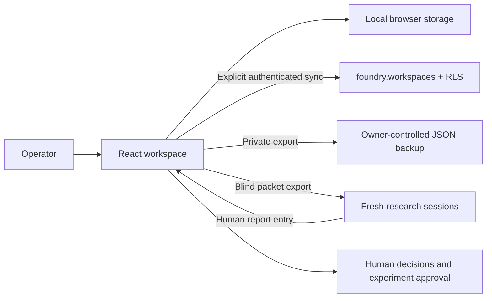

# Architecture

## Requirements and choices

Discovery must explore unmet demand and new capabilities broadly. Triage must compare commercial proof, cash timing and practical constraints without imposing an arbitrary limit on project count, duration or repeatability. The product keeps evidence separate from judgment, allows minority views and retains failed tests.

Vite/React has no server rendering requirement or server API cost in the MVP. Cloudflare can serve the compiled app as static assets. Supabase Auth and its Data API provide optional private persistence. The browser uses a publishable key plus the signed-in user's access token, never a service-role key. Cloudflare Access should protect the operator interface before production use, in addition to database RLS.

## Data and contracts

Workspace JSON schema version 1 contains opportunities, evidence, reports, experiments, decisions, cash and private settings. `src/domain.mjs` validates imports and each UI mutation. Links must resolve to an opportunity; decision evidence must belong to that opportunity. Text is rendered as text by React, never injected as HTML. Sources are plain references, not automatically fetched or executed.

`foundry.members` is an administrator-only admission list. `foundry.workspaces` stores one JSON snapshot per authenticated owner, revision and timestamp. Reads and mutations require both owner identity and membership. The shared project's other authenticated users cannot join or read this app. There are no public tables or public seed records. A schema is a namespace, not isolation by itself: grants and RLS enforce the boundary.

REST contracts: `GET /rest/v1/workspaces?owner_id=eq.<uid>&select=state,revision`; POST for an initial workspace; PATCH filtered by owner and expected revision for subsequent saves. Both profile headers select `foundry`. A zero-row PATCH is a conflict, not a successful save. The trigger requires an increment of one. The client validates JSON shape; DB checks version and size, not the entire application schema. An owner can alter their own data through the API; there is no tamper-proof audit claim.

## Reliability, privacy and tradeoffs

Local mode is single-device, unencrypted browser storage. It has no authentication barrier within that browser profile. Exports are private unencrypted files. Cloud login tokens are memory-only and there is no automatic refresh; expired sessions require another sign-in. Signing out removes the in-memory token, but does not delete local data. Password authentication assumes an existing admin-provisioned Auth user; no signup, password reset, magic links or OAuth flow is implemented.

Snapshot storage avoids a premature backend and makes portable backups simple. Tradeoffs: manual whole-workspace sync, a 4 MB app import limit, no collaborative editing, no server-side record queries and no immutable audit trail. Conflict recovery requires exporting local changes and manually reconciling against a cloud load. Split into normalised tables, migrations and per-record revision control when collaboration or size warrants it.

Initial report hiding is a UI aid only. True independence requires separate contexts and deliberate provider/model diversity. Packets contain only the opportunity brief, role and research protocol, not previous reports, scores or financial baseline. The current release does not execute AI agents, schedule jobs or verify model independence.

GST, PSI, company tax, extraction and personal tax depend on facts and professional assessment. The ledger accepts separately supplied reserves; it is not a tax calculator. Avoid double counting reserves and baseline. Company cash counts only when genuinely accessible personally after applicable obligations. Superannuation and unexercised equity are excluded unless actually realised and accessible on an appropriately supported basis.

## Next smallest extensions

1. Connect approved private persistence and test cross-user isolation on a test database.
2. Run one actual commercial validation cycle before adding automation.
3. After owner approval, add a Cloudflare Worker cron that creates private discovery tasks, with spend limits, idempotent run IDs and no autonomous outreach/deployment.
4. Connect genuinely distinct research providers only after approving credentials and budgets. Log provenance and exposure; blind initial results before synthesis.
5. Add owner-specific financial scenario modelling only with reconciled inputs and reviewed tax assumptions.

## Shared-project escape-hatch review

RLS cannot protect data if an exposed SECURITY DEFINER RPC accepts arbitrary SQL with an owner that bypasses RLS. The connection sprint restricts the optional legacy `public.exec_sql(text)` function to the trusted `service_role`. Browser roles retain no execute grant. This is a necessary shared-project security change; server integrations must not rely on anonymous arbitrary SQL. Tests cover the grant boundary and API-schema list preservation.
